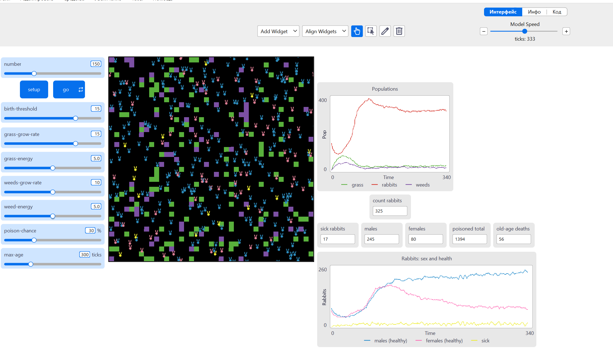
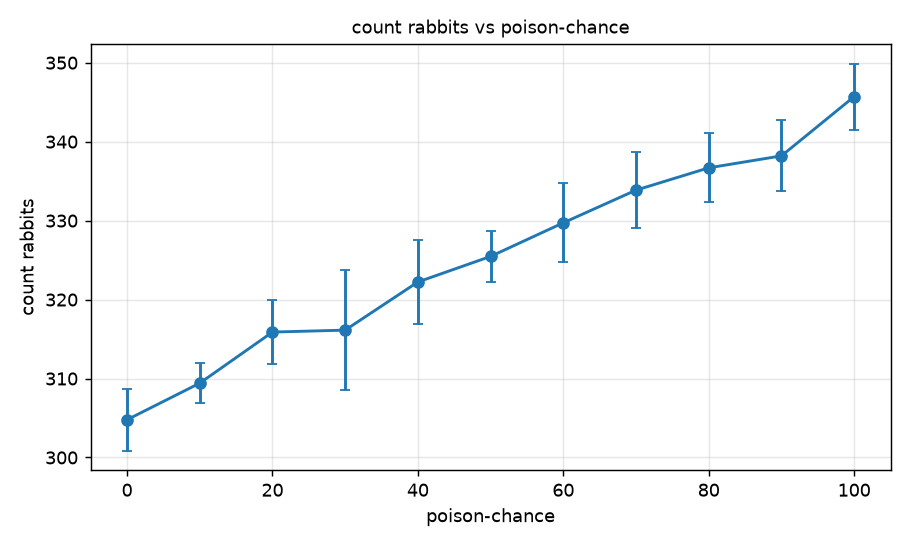

# Комп'ютерні системи імітаційного моделювання

## СПм-25-2, **Лебідь Іван Сергійович**

### Лабораторна робота №**2**. Редагування імітаційних моделей у середовищі NetLogo

<br>

### Варіант 6, модель у середовищі NetLogo:
[Rabbits Grass Weeds](http://www.netlogoweb.org/launch#http://www.netlogoweb.org/assets/modelslib/Sample%20Models/Biology/Rabbits%20Grass%20Weeds.nlogo)

<br>

### Внесені зміни у вихідну логіку моделі, за варіантом:

Завдання варіанта складається з двох частин: **отруєння бур'янами** та **поділ кроликів на самців і самок** зі зміною умов розмноження. Зміни було внесено окремо для кожної частини.

#### 1. Нові властивості кроликів та глобальні змінні
Кожен кролик отримав чотири нові змінні: стать (`sex`), ознаку хвороби (`sick?`), лічильник тактів, що лишились до одужання (`sick-ticks`), та вік (`age`, див. розділ про власні зміни). Тривалість хвороби - внутрішня константа `sick-duration` (3 такти), також додано лічильники для користувача:

```NetLogo
rabbits-own [
  energy        ;; energy of the rabbit
  sex           ;; "male" or "female"
  sick?         ;; true if the rabbit is poisoned
  sick-ticks    ;; how many ticks of the illness are left
  age           ;; age in ticks
]

globals [
  sick-duration    ;; how long a poisoned rabbit stays sick (ticks) - internal constant
  poisoned-total   ;; how many times rabbits were poisoned
  old-age-deaths   ;; how many rabbits died because of old age
]
```

У процедурі `setup` значення ініціалізуються: `sick-duration = 3`, лічильники нульові, кожному початковому кролику випадково призначається стать, він здоровий:

```NetLogo
create-rabbits number [
  setxy random-xcor random-ycor
  set energy random 10  ;start with a random amt. of energy
  set sex one-of ["male" "female"]
  set sick? false
  set sick-ticks 0
  set age random (floor (max-age / 2))
  update-color
]
```

#### 2. Отруєння при поїданні бур'янів
Ймовірність отруєння задається слайдером **`poison-chance`** (0-100 %, за замовчуванням 30). Кролик їсть бур'ян як і раніше (отримує `weed-energy`), але після цього з ймовірністю `poison-chance` отруюється:

```NetLogo
to eat-weeds  ;; rabbit procedure
  ;; gain "weed-energy" by eating weeds, but weeds may be poisonous
  if pcolor = violet
  [ set pcolor black
    set energy energy + weed-energy
    if random 100 < poison-chance [ get-poisoned ] ]
end

to get-poisoned  ;; rabbit procedure
  set sick? true
  set sick-ticks sick-duration
  set poisoned-total poisoned-total + 1
  update-color
end
```

#### 3. Хворий кролик не їсть, не рухається і не розмножується
У головній процедурі `go` поведінка кролика залежить від стану здоров'я. Хворий кролик лише чекає одужання, а здоровий виконує звичайні дії:

```NetLogo
ask rabbits
[ ifelse sick?
  [ recover ]                ;; a sick rabbit cannot move, eat or reproduce
  [ move
    eat-grass
    eat-weeds
    reproduce ]
  get-older
  death ]
```

Процедура `recover` зменшує лічильник хвороби і після 3 тактів повертає кролика у здоровий стан та звичайний колір:

```NetLogo
to recover  ;; rabbit procedure
  ;; a sick rabbit just waits until the illness is over
  set sick-ticks sick-ticks - 1
  if sick-ticks <= 0
  [ set sick? false
    update-color ]
end
```

Оскільки хворий кролик не рухається, він не витрачає енергію на рух і не може вмерти з голоду, поки хворіє. Хвороба не дає енергії, а отже, є чистою втратою часу.

#### 4. Колір кролика
Хворі кролики позначаються іншим кольором (жовтий), здорові самці - блакитні (sky), здорові самки - рожеві:

```NetLogo
to update-color  ;; rabbit procedure
  ifelse sick?
  [ set color yellow ]
  [ ifelse sex = "female"
    [ set color pink ]
    [ set color sky ] ]
end
```

#### 5. Розмноження: стать, ситість, здоров'я та партнер поруч
Нова умова розмноження: кролик має бути ситим (`energy > birth-threshold`), здоровим, а в одній із сусідніх клітин має бути інший ситий здоровий кролик **протилежної статі**. Народження відбувається з імовірністю 50 %.

Щоб один і той самий факт зустрічі партнерів не породжував двох кроленят (по одному від кожного з пари), народжує лише **самка**; самець є тільки партнером і енергію не витрачає:

```NetLogo
to reproduce     ;; rabbit procedure
  ;; only a fed and healthy female can give birth, and only if there is
  ;; a fed and healthy male on one of the neighbouring patches
  if sex = "female" and not sick? and energy > birth-threshold
  [ let partners (rabbits-on neighbors) with [ sex = "male" and not sick? and energy > birth-threshold ]
    if any? partners and random 100 < 50   ;; 50% chance of offspring
    [ set energy energy / 2
      hatch 1 [ become-newborn
                fd 1 ] ] ]
end
```

Новонароджене кроленя здорове, має вік 0 та випадкову стать (50 / 50):

```NetLogo
to become-newborn  ;; rabbit procedure (is called by a newborn rabbit)
  set sex one-of ["male" "female"]
  set sick? false
  set sick-ticks 0
  set age 0
  update-color
end
```

#### 6. Зміна значень за замовчуванням
У вихідній моделі бур'яни вимкнені (`weeds-grow-rate = 0`, `weed-energy = 0`), тож отруєння не мало б сенсу. Тому значення за замовчуванням змінено: **weeds-grow-rate = 10**, **weed-energy = 5**.

<br>

### Внесені зміни у вихідну логіку моделі, на власний розсуд:

**Старіння кроликів.** У вихідній моделі кролик безсмертний, поки вистачає їжі. Додано вік (`age`), що збільшується на 1 щотакту, і слайдер **`max-age`** (50-1000 тактів, за замовчуванням 300): кролик, старший за `max-age`, гине. Початковий вік кроликів - випадковий від 0 до `max-age / 2`, щоб вони не вмирали одночасно. Кількість померлих від старості виводиться на монітор `old-age deaths`.

```NetLogo
to get-older  ;; rabbit procedure
  set age age + 1
end

to death     ;; rabbit procedure
  ;; die of old age or if you run out of energy
  ifelse age > max-age
  [ set old-age-deaths old-age-deaths + 1
    die ]
  [ if energy < 0 [ die ] ]
end
```

**Інтерфейс.** Додано слайдери `poison-chance` та `max-age`, монітори (хворі кролики, самці, самки, всього отруєнь, померлих від старості) та графік "Rabbits: sex and health" з кривими здорових самців, здорових самок і хворих.



Фінальний код моделі та її інтерфейс доступні за [посиланням](Rabbits%20Grass%20Weeds_modified.nlogox).

<br>

## Обчислювальний експеримент

> **Як проводився експеримент:** BehaviorSpace, експеримент `L2-E1 poison-chance` у файлі `Rabbits Grass Weeds_modified.nlogox`. Кожне значення - 10 прогонів по 1000 тактів; значення записувались на кожному такті, для усереднення взято такти 300-1000. Параметри, що не досліджуються, зафіксовано на значеннях за замовчуванням.

### 1. Вплив отруйності бур'янів на чисельність кроликів та кількість хворих
Досліджується залежність усталеної кількості кроликів, кількості хворих кроликів і сумарної кількості отруєнь від параметра **poison-chance**. Значення: 0, 10, …, 100 % (11 значень).  
Інші параметри мають значення за замовчуванням:
- **number**: 150
- **birth-threshold**: 15
- **grass-grow-rate**: 15
- **grass-energy**: 5
- **weeds-grow-rate**: 10
- **weed-energy**: 5
- **max-age**: 300

| poison-chance | count rabbits | хворих кроликів | poisoned-total |
|:---:|:---:|:---:|:---:|
| 0 | 304,78 | 0,00 | 0,00 |
| 10 | 309,42 | 4,31 | 934,03 |
| 20 | 315,89 | 8,73 | 1849,66 |
| 30 | 316,13 | 13,09 | 2785,86 |
| 40 | 322,23 | 17,53 | 3740,96 |
| 50 | 325,47 | 21,73 | 4611,89 |
| 60 | 329,72 | 26,35 | 5586,12 |
| 70 | 333,86 | 30,52 | 6472,10 |
| 80 | 336,69 | 34,69 | 7370,18 |
| 90 | 338,20 | 39,03 | 8323,19 |
| 100 | 345,71 | 43,55 | 9233,44 |



*Висновки:* всупереч очікуванню, зі зростанням отруйності бур'янів кролики не вимирають, а їх навіть трохи більшає: від ≈305 при 0 до ≈346 при 100. Імовірно, це через те, що хворий кролик не рухається й витрачає менше енергії. При 100 % хворими є ≈44 кролики, тобто близько 13 % популяції.
